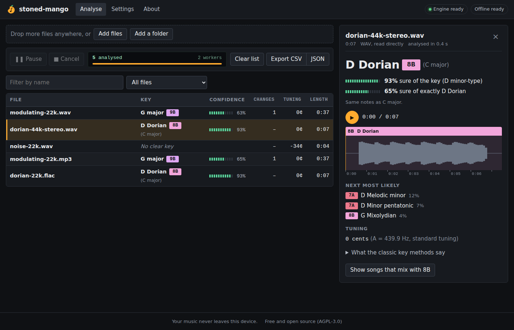
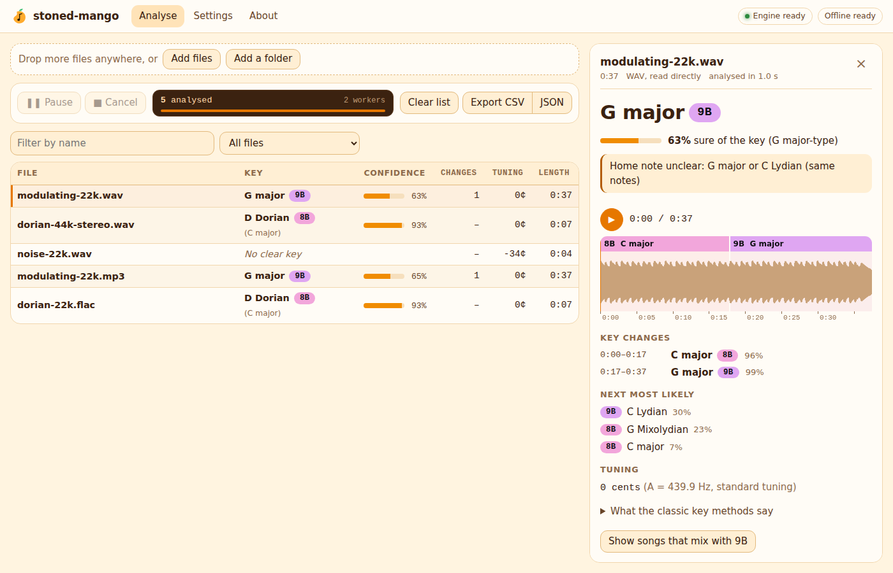
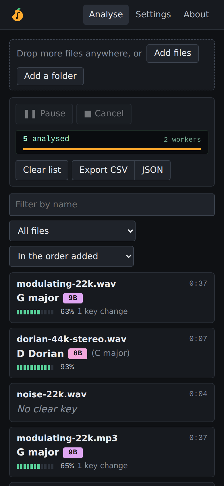
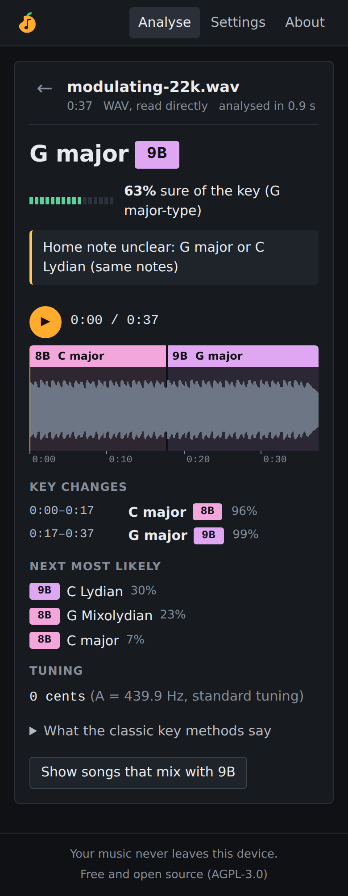
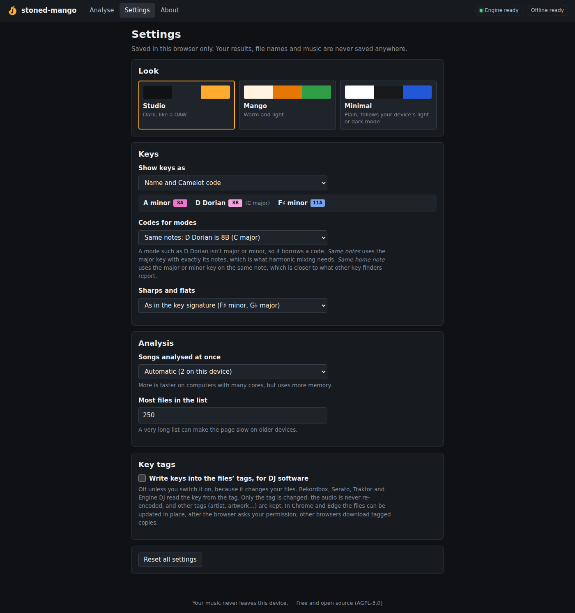

# Phase 6 report: the app

**Status:** done. stoned-mango is now a real app. Drop songs or a whole folder and the keys fill in as each file finishes. Click a song to see its timeline and play it. Export the results, and optionally write the keys into the files' tags. It works on phones and computers, and after the first visit it works with no internet connection. Your music is still never uploaded: an automated test checks that no network request happens while files are analysed or tagged.

Try it: `cd web && npm run build && npm run preview`, then open the page.

| Studio skin (default) | Mango skin |
|---|---|
|  |  |

| Phone: the list | Phone: one song | Settings |
|---|---|---|
|  |  |  |

## 1. What you can do

**Add music**
- Drop files or whole folders anywhere on the page, or use the buttons.
- Folders are searched recursively. Anything that isn't audio is skipped, and so are the hidden `._song.mp3` files that macOS leaves on external drives. The app says how many files it skipped.
- In Chrome and Edge, the buttons use the browser's own file and folder pickers. Their permission prompt says "view files", not the old "upload files" wording, and they let tags be written back later.
- The list holds up to 250 files; Settings can raise this. On a phone, adding more than 20 files asks first, because it takes a while and uses battery.

**Watch the batch**
- A DAW-style transport bar shows Pause/Resume and Cancel, plus an "LCD" with the count, the time left and the number of workers.
- In a test with 60 songs, the time-left estimate was about 30% high at the start and right from about halfway on.
- The page stays smooth while it works: at 60 frames a second, the longest frame was 50 ms.

**Browse the results**
- On a computer, a table that sorts by name, key, confidence, key changes, tuning or length. Sorting by key goes around the Camelot wheel (1A, 1B, 2A…), so keys that mix well sit together.
- On a phone, a list of cards.
- Filters:
  - by name
  - major, minor, or modes and other scales
  - songs with key changes
  - songs less than 50% sure
  - no clear key
  - problems
  - **"Show songs that mix with 8A"**: same code, one step around the wheel, or the relative key

**One song**
- The key, large, with its code, and how sure the app is:
  - **Key:** how sure it is of the home note and major/minor. This is the number calibrated on real music.
  - **Mode:** for a mode, how sure it is of that exact mode.
- The honest ambiguity note, when there is one.
- **The timeline:**
  - Sections coloured like the Camelot wheel (so 8A and 9A look related), over the song's loudness.
  - Click or tap to move the playhead. The arrow keys work too.
  - Playback uses the file on your device, so nothing is fetched.
- Also shown: the list of key changes, the next most likely keys (each with its code), tuning (for example "+14 cents, A = 443.6 Hz"), and what the classic key methods say.

**Exports.** CSV (opens in Excel with the right characters) and JSON, made on the device. They contain the rows you're looking at (respecting filters), with Camelot, Open Key and the mixing key added.

## 2. How keys are shown (your choice: name and code)

| Result | Shown as | Why |
|---|---|---|
| A minor | **A minor · 8A** | |
| C major | **C major · 8B** | |
| D Dorian | **D Dorian · 8B (C major)** | Same notes as C major, which is what harmonic mixing needs |
| E Phrygian dominant | **E Phrygian dominant · 8A (A minor)** | It is the 5th mode of A harmonic minor. E major (12B) would clash on 3 notes; A minor clashes on one |
| A minor pentatonic | **A minor pentatonic · 8A (A minor)** | |

**The rule** (`web/src/ui/notation.ts`, tested on all 30 scales × 12 tonics):
1. Take the major/minor keys whose notes differ least from the scale's.
2. Among those, prefer the one with the same home note.
3. If there isn't one, take the key of the scale it is a mode of.
4. Otherwise, take the home-note key.

**Settings**
- **Key display:** the name only, Open Key (`1m`/`1d`), or a code only.
- **Codes for modes:** "same home note" (D Dorian → 7A, D minor) instead of "same notes". This is closer to what other key finders report.
- **Sharps and flats:** key-signature spelling (F♯ minor, G♭ major), always sharps, or always flats.

## 3. Skins

Each skin is a set of colour and shape tokens. Every component uses only those tokens, so adding a skin means adding one block of CSS. Only system fonts are used: nothing is fetched from font services.

| Skin | Look |
|---|---|
| **Studio** (default) | Dark graphite panels, amber accents, a green "LCD" status display and segmented level meters, like a DAW |
| **Mango** | Warm cream and orange, rounded, friendlier |
| **Minimal** | Plain white with blue. It follows the device's light or dark mode |

## 4. Key tags (optional, off by default)

**When it's switched on**, "Write key tags…" tags the rows in view, and each song has a "Write key tag" button.

**What gets written**
- **TKEY:** the key DJ software reads, in standard (`Am`), Camelot (`8A`) or Open Key (`1m`) form.
  - It is the same key as the code on screen, so D Dorian is tagged `C`/8B by default, or `Dm`/7A with the "same home note" setting.
- **TXXX:KEY_MODE:** optional, the full result ("D Dorian").
- **WAV:** an `id3 ` chunk.

**How it's saved**
- **Chrome and Edge:** in place, after the browser asks for permission. It asks once per folder; files picked one by one ask one by one.
  - The browser writes into a temporary copy and only swaps it in when the write is complete.
  - The app then reads the tag back to check it.
- **Other browsers:** one tagged copy, or a .zip of copies with the folder structure kept.

**Safety: our own small ID3 editor** (`web/src/ui/tagging/`). The library planned in phase 0 (browser-id3-writer) replaces the whole tag, which would drop artwork and other tags.
- **Kept byte for byte:** every frame except the key frames.
- **Read:** ID3v2.3 and v2.4, unsynchronisation, extended headers, and the v2.4 frame sizes some taggers get wrong.
- **Not risked:** an old ID3v2.2 tag, a tag with junk in it, or an unusual WAV layout. The file is skipped with the reason shown.
- **The audio isn't moved** if the new tag fits in the old tag's padding.

**Checked against an independent tagger**
- `python -m stoned_mango.tag_fixtures` writes test files with **mutagen**: artwork, UTF-16 text, an old TKEY, other TXXX frames, ID3v1, v2.4 padding, and WAV with RIFF INFO.
- `web/tests/tagging.test.ts` tags them. `research/tests/test_tag_fixtures.py` then reads the results back with mutagen. Both run in CI.
- **mutagen confirmed:**
  - our TKEY and KEY_MODE are readable
  - every tag it wrote itself is unchanged
  - the MP3s still decode to the same length, and the WAV samples are identical
  - the .zip is valid

## 5. Works offline

- A service worker keeps the app's own files on the device: about 17 MB, mostly the analysis engine.
  - The build lists exactly the files the app references, starting from `index.html`. This leaves the old benchmark page out.
  - The cache is versioned by the files' contents.
- When a new version is published, the app shows "A new version is ready. Reload to update" rather than switching while you work.
- "Offline ready" appears in the top bar once everything is saved. You can also add the app to your home screen (manifest and icons).
- **A bug found by the offline test, and fixed:** the server sends `Vary: Origin`, and the browser requests scripts with an `Origin` header. So the cached copies didn't match, and an offline reload failed some of the time. The service worker now ignores `Vary` for its own files.

## 6. Tests

| Test | What it checks | Result |
|---|---|---|
| `web/tests/notation.test.ts` | Camelot/Open Key for all 24 keys against the published wheels; the mode rule; spelling; compatible keys; settings validation; CSV/JSON export (including spreadsheet formula safety) | 11 pass |
| `web/tests/tagging.test.ts` | Tags written, audio and other frames untouched, tagging twice changes nothing, the zip, the refusals, a WAV missing its final pad byte | 12 pass |
| `research/tests/test_tag_fixtures.py` | mutagen reads our outputs (see §4) | 10 pass |
| `web/tests/parity.test.ts` | the engine still matches Python | 12 pass |
| `web/tests/browser.mjs` (headless Chromium) | the five golden files through the real interface, plus each of the steps below | passes (4 of 4 runs) |

The browser test's steps:
- **Privacy:** no network request at all while analysing and tagging, counted across the whole browser context (including the service worker).
- **Interface:** the table, the song view, timeline seeking, the "mixes with" filter, settings (notation, skin, saved as preferences only) and the CSV download.
- **Tagging:** tagged copies as a zip, checked in Node. Then an in-place write through the File System Access API, on the browser's private file system, which needs no picker.
- **Offline:** the network switched off, the page reloaded, and a file analysed.

Python suite: 216 pass.

## 7. Limits and next steps

- **Phones:** still need a real-device check, with the Cloudflare preview link (phone speed, memory, the layout on your phone, and add-to-home-screen).
- **Safari and Firefox:** they can't write tags in place, so they get tagged copies. Firefox and older Safari also lack WebCodecs MP3, so MP3s there use the slower fallback (phase 5).
- **DJ software:** not every DJ program reads key tags from WAV files (the `id3 ` chunk). Settings says so. Worth checking with your own software on one copy first.
- **Phase 7 (launch):**
  - the strict Content-Security-Policy (the one inline script, which applies your skin before the first paint, will get a hash)
  - the Privacy, Accuracy and Donate pages
  - deployment
