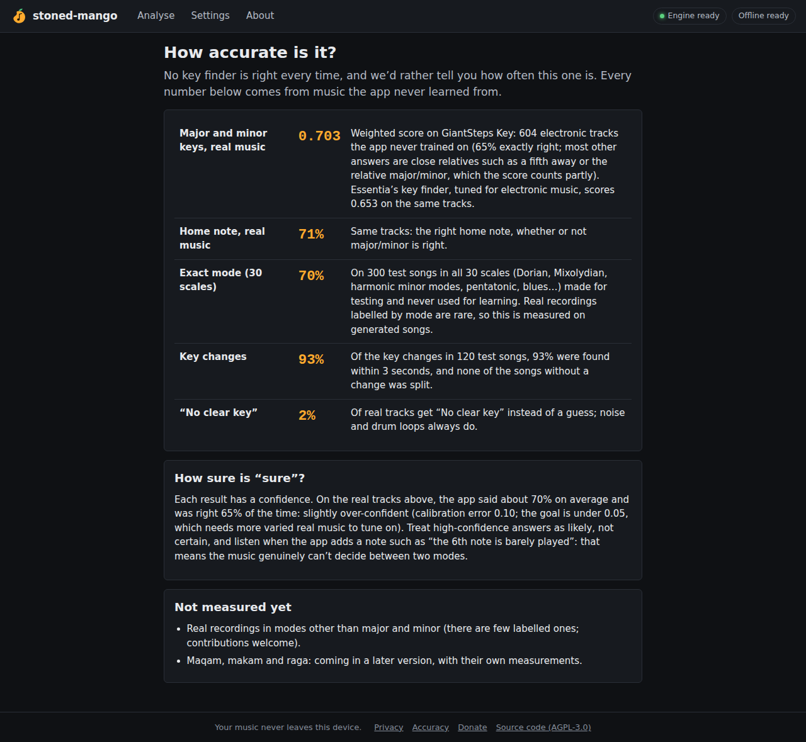
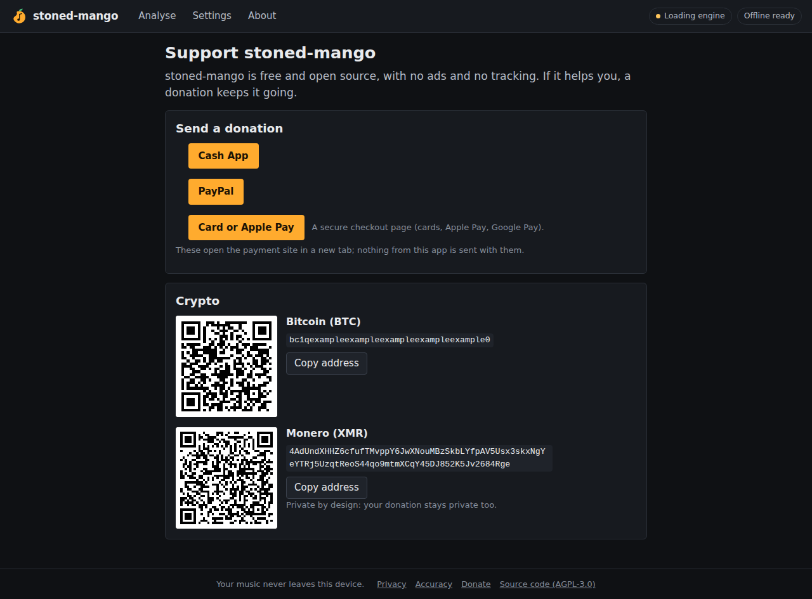

# Phase 7 report: ready to launch

**Status:** everything is built and tested. Two things need you before the site goes live:
- **Cloudflare:** the account details, so the site can be published (about 10 minutes, no coding; §4).
- **Donations:** the handles and addresses to show on the Donate page (§3).

## 1. The privacy promise, enforced by the browser

The site is now served with a strict **Content-Security-Policy**. The browser itself enforces it, and anyone can read it in the developer tools:

| Rule | What it means |
|---|---|
| `connect-src 'self'` | The page can only fetch the site's own files. Sending anything to another site is blocked by the browser. |
| `script-src 'self' 'wasm-unsafe-eval'` + one hash | Only the site's own scripts run. The single small inline script (which applies your skin before the first paint) is allowed by its exact hash, computed by the build. |
| `default-src 'none'`, `frame-ancestors 'none'`, `form-action 'none'`, `base-uri 'none'` | Nothing else is allowed: no frames, no forms, and the page can't be embedded in other sites. |

**Other headers:**
- `X-Content-Type-Options`, `Referrer-Policy: no-referrer`, `X-Frame-Options`, `Cross-Origin-Opener-Policy`.
- A `Permissions-Policy` that turns off the camera, microphone, location and payment APIs.
- Caching rules: the app's files are cached for a year, because their names change with every version. The page and the service worker are always revalidated.

**One honest exception: the analysis workers.**
- Essentia.js's WebAssembly glue builds small functions at run time, which needs `'unsafe-eval'`.
- So the workers get their own policy (a worker follows the policy its own script is served with), and only they get this.
- Their `connect-src` is still `'self'`, so they can't send anything away either.

**How it's made and tested**
- `web/build/headers.ts` writes `dist/_headers`, which Cloudflare Pages serves.
- `vite preview` serves the same file, so every test runs under the real policy.
- The browser test now also checks:
  - the page arrives with its policy
  - the app causes **no policy violations** while it analyses, tags and changes settings
  - a test request to another site **is blocked by the browser**
  - offline, the page served by the service worker still carries the policy
- Unit tests check each path gets the right policy, and that the policy contains no wildcard, no `unsafe-inline` and no outside site.

**Also:** the phase 0 benchmark page is no longer part of the site build (`npx vite build --mode spike` builds it for the benchmark).

## 2. New pages

| Accuracy | Donate (with example details) |
|---|---|
|  |  |

They are linked from the footer of every page.

**Privacy**
- What happens to your files, and what is stored: only your settings, and the app itself for offline use.
- Four ways to check it yourself: Wi-Fi off, the Network tab, the policy header, and the code and its tests.
- The fine print: the host sees that someone loaded the page.

**Accuracy**
- The measured numbers, all on music the app never learned from:

  | Measure | Result |
  |---|---|
  | GiantSteps weighted score | 0.703 (Essentia: 0.653) |
  | Home note | 71% |
  | Exact mode, 30 scales | 70% |
  | Key changes found within 3 s | 93% |
  | Real tracks given "No clear key" | 2% |

- An honest note on calibration: it says about 70% on average and is right 65% of the time.
- What isn't measured yet.
- Your own library results are not on this public page.

**Donate**
- Plain links (Cash App, PayPal, a card/Apple Pay checkout link, GitHub Sponsors, Liberapay) and crypto addresses (BTC, ETH, SOL, XMR).
- Each address has a QR code and a copy button. The ETH entry says which network to use, and Monero is noted as private for donors too.
- No payment widget or third-party script runs on the site. The QR codes are made at build time as plain images (`web/build/donate.ts`).
- Until details are filled in, the page says "Donation links are coming soon".

**Also:** `.github/FUNDING.yml` (the GitHub "Sponsor" button) is ready, with its lines commented out until there are details to put in.

## 3. What I need from you: donation details

Fill in `web/donate.json`, or just send me the details and I'll do it:

| Field | Example | Shown as |
|---|---|---|
| `cashApp` | `$yourtag` | Cash App link |
| `paypal` | `yourname` (from paypal.me/yourname) | PayPal link |
| `checkout` | a Stripe Payment Link or Ko-fi page | "Card or Apple Pay" (Apple Pay works through these) |
| `githubSponsors`, `liberapay` | user names | links |
| `crypto.BTC` / `ETH` / `SOL` / `XMR` | wallet addresses | QR code, address and copy button |
| `ethNetwork` | `Ethereum mainnet` | the network warning |

The build refuses a malformed address or a non-https checkout link, so a typo can't ship.

## 4. Publishing (Cloudflare Pages)

> The full walk-through, from creating the Cloudflare account to the live site, is in [docs/LAUNCH.md](../LAUNCH.md).

`.github/workflows/deploy.yml` builds the site on GitHub from the public source, runs the tests, and publishes it.
- **Pushes to `main` go live.**
- **Pushes to any other branch get their own preview link** (for testing on your phone).
- Until the two secrets below exist, it stops after a notice and changes nothing.

**One-time setup (no coding):**
1. Create a free account at cloudflare.com.
2. Copy your **Account ID**: open *Workers & Pages* in the dashboard; it's shown on the right.
3. Make an **API token**: *My Profile → API Tokens → Create Token → Create Custom Token*. Give it one permission, **Account → Cloudflare Pages → Edit**, then create it and copy it.
4. On GitHub: open the repository's *Settings → Secrets and variables → Actions → New repository secret*. Add:
   - `CLOUDFLARE_API_TOKEN`
   - `CLOUDFLARE_ACCOUNT_ID`
5. Run the **Deploy** workflow (*Actions* tab), or push anything.
   - It creates the Pages project the first time.
   - The site appears at `https://stoned-mango.pages.dev`, with previews at `https://<branch>.stoned-mango.pages.dev`.

A custom domain can be added later in the Pages project's settings.

## 5. Tests

| Test | Result |
|---|---|
| `web`: unit tests | 40 pass (adds the header and donation checks) |
| `web`: browser test (headless Chromium, under the real policy) | passes 4 of 4 runs. It now also opens the Privacy, Accuracy and Donate pages, and runs the policy checks above |
| `research` | unchanged; 216 pass |

## 6. Your decisions since

- **Modes are tagged by the key with the same notes** (D Dorian → `C`, 8B), matching the code on screen. This was already the default; it is now recorded as decided.
- **Traktor Pro:** Settings now explains how Traktor uses the tag.
  - The tag appears in Traktor's *Key Text* column. For tracks already in your collection, run *Check Consistency*.
  - Traktor's own *Key* column doesn't accept Camelot, so **Open Key** (Traktor's notation) or standard tags work best there.
  - Traktor stores its own data for WAV files in a private chunk, so check one tagged WAV in Traktor before tagging a whole folder.
- **FL Studio** doesn't read key tags, so the app now shows **the scale's notes** for its piano roll's scale highlighting:
  - In the song view: "D Dorian → D E F G A B C", with the home note marked and a Copy button.
  - On each key-change section.
  - In a new `scale_notes` column in CSV and JSON exports.
  - Seven-note scales use each letter once, as on a score (D harmonic minor: D E F G A B♭ C♯, not D♭).
  - The "always sharps" setting gives piano-roll names (D♯ rather than E♭).
  - Unit tests cover all 30 scales in all 12 keys, and the browser test checks the notes appear.

## 7. After launch

- **Phones:** open a preview link on your phone to check speed, memory, layout and add-to-home-screen.
- **Phase 8:** maqam, makam and raga (tiers 3a–3c).
