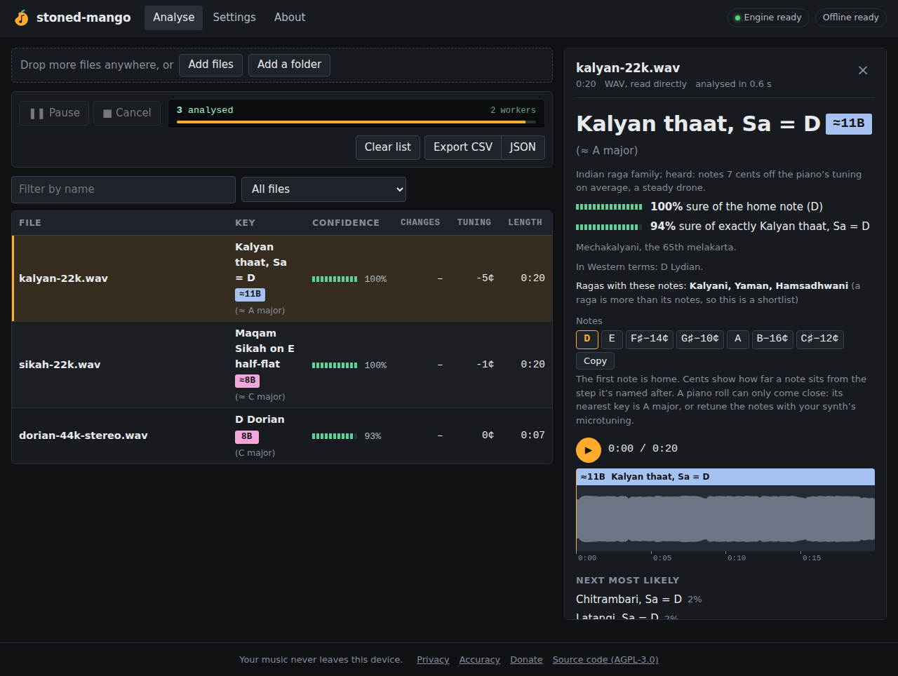

# Phase 8 report: maqam, makam and raga-family scales

**Status:** done. Built, tested, and measured on real Turkish and Carnatic recordings and on your library (its results stay private).
- The first "Automatic" gave a maqam, makam or raga name to 8% of the GiantSteps tracks (§7).
- **Refitted on your PC's per-song measurements (§8):** 0 of 604 GiantSteps tracks.
- But it now recognises only about 1 in 7 real makam and 1 in 10 Carnatic recordings. So, as you chose, the default stays **"Never: Western scales only"**; "Always, <tradition>" is the choice for people who play that music.

## 1. What the app does now

**106 new scales** (`shared/scales.json`, tier 3), all three traditions together as you chose:

| Tradition | Scales | Their notes |
|---|---|---|
| Arabic maqam | 15: Rast, Bayati, Sikah, Saba, Hijaz, Nahawand, Kurd, Ajam, Huzam, Iraq… | quarter tones (E half-flat = 350 cents) |
| Turkish makam | 19: Rast, Uşşak, Hicaz, Hüseyni, Karcığar, Saba, Segah, Nihavent… | the 53-comma steps of Turkish theory |
| Indian | all 72 melakartas, with the 10 Hindustani thaats named (Kalyan, Bilawal, Bhairav, Todi…) | just intonation (the third 14 cents below the piano's) |

On screen and in exports a result looks like this:

| Result | Shown as | Tag (TKEY) |
|---|---|---|
| Maqam Sikah on E half-flat | **≈8B** (≈ C major) | C (the nearest key, as you chose) |
| Kalyan thaat, Sa = D | **≈11B** (≈ A major) · *Mechakalyani, the 65th melakarta* | A |
| Maqam Bayati on D | **≈7A** (≈ D minor) | Dm |

- **Notes for FL Studio and the like.** One letter per degree, with quarter tones (½♭) and cents where a note sits between the keys. Examples:
  - Sikah: `E½♭ F G A B½♭ C D`
  - Kalyan on D: `D E F♯−14¢ G♯−10¢ A B−16¢ C♯−12¢`

  A piano roll can only come close, so the song view also names the nearest key.
- **In Western terms.** The Western engine's answer is shown too ("In Western terms: D Lydian"), so a DJ always has the familiar name.
- **Ragas.** For Indian results, a shortlist of ragas with the notes heard (Kalyani, Yaman, Hamsadhwani…). A raga is more than its notes, so this is a shortlist, not a verdict.
- **Settings → Maqam, makam and raga scales:**
  - Never: Western scales only (the default since your PC's run, §7)
  - Automatic: only when a song clearly shows them (refitted, §8)
  - Whenever one fits better than a Western scale
  - Always one tradition
- **Elsewhere in the app:**
  - A table filter "Maqam, makam and raga".
  - CSV columns `tradition` and `ragas`.
  - The JSON export carries everything, including the evidence.
- The same engine runs in Python (`research/stoned_mango/world.py`) and in the browser (`web/src/engine/world.ts`). Two new golden clips check they agree, down to the intermediate values.

## 2. How "Automatic" decides

A maqam, makam or raga name replaces the Western answer only when all of these hold:

1. **The audio shows it.**
   - Either the melody's notes sit, on average, 2.5+ cents away from the piano's tuning,
   - or a drone (a note plus its fifth) sounds most of the time.
2. **A tier 3 scale fits clearly.** It fits the melody better than every Western scale, with the same home-note clues on both sides.
3. **The scale matches the evidence:**
   - Quarter-tone scales need quarter tones to be heard.
   - With a drone but in-tune notes, only the Indian scales.
   - A maqam or makam that sits on the piano's keys (Kurd is Phrygian by another name) needs clearly non-piano intonation.
4. **New:** for a maqam or makam, **the Western engine must be less than 90% sure of its key** (§4).

**Refitted after your PC's runs (§8):** a maqam or makam must now beat the best Western scale by 0.10 (not 0.02), every tier 3 scale must fit at least 0.65, and an Indian scale needs a drone.

How each candidate is scored:
- Each scale is a template on a 120-step pitch profile (10 cents a step) of the lead melody. The home note is placed on a quarter-tone grid.
- Home-note clues are added: the bass, the drone, and (new, §4) the notes the music ends on.

## 3. Results

**Real Turkish makam recordings** (OTMM dataset: 1,000 commercial recordings, 20 makams; measured from their melody pitch tracks, as the dataset has no audio):

| Held-out half (475 recordings, 19 makams) | |
|---|---|
| Home note (karar) within 25 cents | **84%** |
| Home note taken for the fifth or fourth | 5% |
| Exact makam | 42% |
| Home note and a makam with the same notes | **49%** |

Notes on these numbers:
- The other half was used to set the new "ending" clue.
- On both halves together: home note 86%, home and makam 50%.
- By makam, the best are Saba 86%, Acemkürdi 86%, Rast 82% and Hicaz 74%.
- The weakest are Muhayyer, Kürdilihicazkar and Hüzzam:
  - Muhayyer has the same notes as Hüseyni and Neva.
  - Kürdilihicazkar and Hüzzam are played differently from the textbook intervals.
- These limits are known for any approach that looks at notes only. Telling Hüseyni from Muhayyer needs the melody's direction (seyir).

**Test songs** (212 generated for testing in all 106 scales, held out; separate from the songs used for fitting):

| When the app names a tier 3 scale | Arabic | Turkish | Indian | All |
|---|---|---|---|---|
| How often it does (Automatic) | 40% | 53% | 90% | 76% |
| Home note right | 100% | 95% | 100% | 99% |
| Exact scale | 100% | 80% | 81% | 82% |

- Arabic is named less often because 7 of the 15 maqamat sit on the piano’s keys (Kurd, Nahawand, Hijaz…). Their Western name says the same, so Automatic keeps it.
- Confidence is honest: calibration error 0.05.

**Ordinary music left alone (Automatic):**

| Set | Given a tier 3 name |
|---|---|
| 150 generated Western songs | 0 |
| 40 noise and drum clips | 0 |
| 10 real electronic tracks (GiantSteps) | 0 |

These turned out to be far too few: on your PC, the full GiantSteps set and your library tell a different story (§7).

## 4. What the real recordings taught

Two changes came straight from testing on real music instead of only on generated songs:

1. **The ending clue.**
   - On real makam recordings the first version found the home note only 63% of the time. In 22% of cases it picked the dominant (fifth or fourth), which these melodies dwell on.
   - These traditions end on the home note (the karar, Sa), so the notes of the last 5 seconds are now a home-note clue.
   - Home note went from 63% to 84–89%, and home plus makam from 36% to 49%.
2. **Western engine first.**
   - On real electronic tracks, the intonation test fired for half of them. One was even named "Maqam Saba": it is tuned 42 cents away from standard pitch, with parts that seem tuned differently, and that looks like quarter tones.
   - In all such cases the Western engine was very sure of the key (93% and up), and on Arabic and Turkish test songs it usually isn't.
   - So a maqam or makam now needs the Western engine to be under 90% sure.
   - The Indian thaats are exempt: they are Western modes on the piano's keys under other names (Kalyan = Lydian), so naming them never contradicts the Western key.

## 5. What I need from you: one double-click

**`world-windows.cmd`** (30–60 minutes; nothing is uploaded or changed):

| Step | What it measures |
|---|---|
| Turkish makam (OTMM) | the numbers above again, on your PC (a sanity check) |
| Indian raga (CompMusic raga dataset, 780 recordings, from Zenodo) | Sa, the parent melakarta, the raga's notes in the scale found, the raga in the shortlist |
| GiantSteps (604 tracks) | how often a real electronic track wrongly gets a tier 3 name |
| Your music (optional, up to 1,000 songs) | the same, on the music you actually play |

**What happened next:** see §7 and §8. Both runs are done; the second run's per-song measurements fitted the gate.

## 6. Limits

**Not measured on real recordings yet:**
- Arabic maqam. There's no open dataset with labelled maqam and tonic that I could use. Turkish makam is the closest relative.
- Hindustani music: the raga dataset's download had Carnatic recordings only.
- Real maqam/makam/raga *audio* (all real numbers come from pitch tracks), so the gate can only be checked for not naming ordinary songs, not for finding real ones.

**Missing makam:** Bestenigar (one of OTMM's 20) isn't in the library yet.

**Pitch tracks vs audio:** the real makam numbers come from pitch tracks, not audio. So they measure the scale templates and the home-note grid, without the bass and drone clues the app also uses on audio.

**Exact raga names:** need melody analysis (phase 9, research).

## 7. Results from your PC (first run)

| | Result |
|---|---|
| Turkish makam (OTMM, 950) | home note 86%, home and makam 50%: the same as here |
| Carnatic (CompMusic raga dataset, 477) | **Sa within 25 cents: 86%** (Sa taken for Pa or Ma: 8%) |
| ... of which 168 in ragas the app knows by name | parent melakarta 46%, the raga's notes all in the scale found 48%, the raga in the shortlist 32% |
| GiantSteps (604 real electronic tracks) | **8.3% got a maqam, makam or raga name** (13 Arabic, 21 Turkish, 16 Indian) |
| Your music | results kept private |

**What went wrong:**
- The intonation test ("notes 2.5+ cents off the piano's tuning, on average") fired for nearly every real track. Generated Western songs are perfectly in tune; real recordings aren't (vibrato, detuned layers, pitch drift). So in practice the gate rested on the template comparison alone.
- Even the strictest Western margin measured (0.06) still named 2.5% of GiantSteps, and it would cut real makam use to a fifth.

**What changed now:**
- The default is "Never: Western scales only" in the app, the command line and the engine.
- `world-windows.cmd` now records, for every song, each number the gate uses: deviation, quarter tones, drone, tuning and how steady it is, the Western engine's key and confidence, and each tradition's best scale with its fit, score and home note. No names.
- It caches each song's features in its own data folder (never next to your music), so the second run skips the slow part for GiantSteps and your songs.

**What I asked for (done):** a second run of `world-windows.cmd`, from the latest version of the project:

1. Download the ZIP (no login needed; the repository is public):
   **https://github.com/freener0x/stoned-mango/archive/refs/heads/claude/audio-key-detection-khkh02.zip**
2. Right-click the ZIP → **Properties** → tick **Unblock** (if it's there) → **OK**.
3. Right-click the ZIP → **Extract All…** → choose the same folder as before → **Extract**. When Windows asks, choose **Replace the files in the destination**. Your earlier results and the datasets are kept.
4. Double-click **`world-windows.cmd`**. Drag your music folder onto the window, then press Enter. If Windows says "Windows protected your PC", click **More info** → **Run anyway**.
5. Upload `SUMMARY.md` and the four `.json` files from the new `results\` folder to our chat. Keep `your-music-tier3.csv` to yourself.

The same steps are in the [Windows guide](../phase2/TRAINING-ON-WINDOWS.md#getting-the-latest-version-whenever-i-change-the-scripts).

## 8. The refitted "Automatic" (second run)

**What the per-song measurements showed:**
- Real Western audio looks *more* out of tune to the intonation test than the real makam recordings do, both in distance from the piano's tuning and in quarter-tone share. So intonation can't tell them apart; only the scale fit can.
- Many of your minor-key songs fit Bayati, Uşşak or Kürdi-like scales almost as well as Aeolian or Phrygian. Those scales differ only by a slightly flat second.

**The search:**
- I replayed the gate on the uploaded measurements over a grid of settings.
- I chose the settings on GiantSteps and on 212 synthetic songs, and kept your library and 212 other synthetic songs for checking.
- The result:
  - Arabic and Turkish scales must beat the best Western scale by **0.10**.
  - Indian scales must just beat it, but need a **drone** (0.55).
  - Every scale must fit at least **0.65**.
  - The earlier rules stay: quarter tones heard, notes off the piano's tuning, and a Western engine under 90% sure, for a maqam or makam.
- The code makes the same call as the replay on 572 of 574 synthetic songs, and is stricter on the other 2.

| | Given a maqam, makam or raga name |
|---|---|
| GiantSteps (604 real electronic tracks) | **0** (first version: 50) |
| Your library (held out) | results kept private |
| Generated Western songs (150), noise and drum clips (40) | 0 |

| What Automatic still recognises | |
|---|---|
| Synthetic test songs (212, held out) | 31%: Arabic 17%, Turkish 18%, Indian 38% |
| ... and when it does | home note 100%, exact scale 94% |
| Real makam recordings (replay from pitch tracks, so without the drone and bass clues) | about 1 in 7 |
| Real Carnatic recordings (same) | about 1 in 10 |

**The decision (yours):**
- The default stays Western scales only. Your library has little or no music in these traditions, so Automatic could only cost you a few wrong names.
- Automatic is no longer labelled experimental. Its Settings hint says it misses most real maqam and raga recordings, and that "Always, <tradition>" is the choice for that music.

**Confidence:** on the answers Automatic gives, it says about 77% and is right about 94% of the time. It is cautious, which is the safe direction.

## 9. Files

**Research (Python):**
- `research/stoned_mango/tier3_data.py`: the scales and ragas
- `world.py`: the engine
- `worldgen.py`, `world_eval.py`: generated test songs
- `world_real.py`: the real-recording checks and summary
- `analysis.py`, `cli.py`: Western first, `--traditions`
- `golden.py`: two tier 3 clips

**Browser:**
- `web/src/engine/world.ts`
- `analysis.ts`, `worker.ts`, `pool.ts`: the setting reaches the workers
- UI: `notation.ts` (≈ codes, tier 3 notes), `SongView.tsx`, `SettingsPage.tsx`, `table.ts`, `exporters.ts`, `AccuracyPage.tsx`

**PC script:**
- `world-windows.cmd`
- `scripts/linux/world.sh`
- `scripts/windows/run-in-wsl.ps1` (new `world` step)

**Tests:**

| Suite | Result |
|---|---|
| Python (including 13 tier 3 tests) | 231 pass |
| Web unit and parity (tier 3 values, labels, notes, ≈ codes, tags, CSV, filter) | 55 pass |
| Browser test | passes |

The browser test checks the tier 3 labels, the notes in cents, the raga shortlist, the Western name, the tags, and that "Never" reaches the workers.
